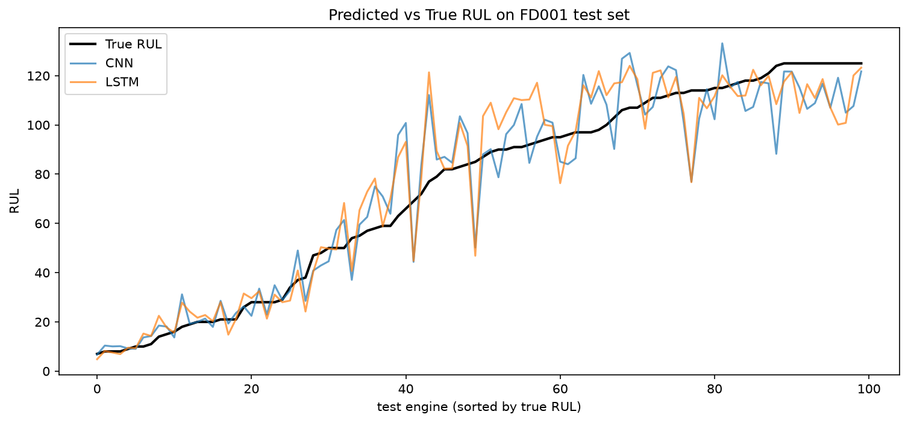

# ✈️ Predictive Maintenance: Turbofan Engine RUL

A 1D CNN and an LSTM that predict how many cycles a jet engine has left before it fails, using NASA sensor data. The LSTM is off by about 13.5 cycles on average, and both models are most accurate right before failure, which is when it matters most.

**RUL (Remaining Useful Life)** = how many more cycles (flights) an engine can run before it breaks.



## Results

| Model | Params | Val RMSE | Test RMSE | Notes |
|---|---|---|---|---|
| 1D CNN (no RUL cap) | 16.8k | ~43 | | Basically guessing the average |
| 1D CNN | 16.8k | 14.66 ± 0.16 | 14.65 ± 0.24 | ~3.5x smaller than the LSTM |
| **LSTM** | **58k** | **13.11 ± 0.25** | **13.53 ± 0.19** | Best. Won on every seed |

RMSE is in cycles, lower is better. Results are the average of 3 runs with different seeds.

Dataset: NASA C-MAPSS FD001, 100 training engines (run until failure), 100 test engines (cut off early), 21 sensors. Split 80/20 by engine (seed 42).

## What I learned

**1. Time series data is shaped differently than tabular data.**
In something like Titanic, one row = one example. Here, one row is just a noisy snapshot of one flight, and it doesn't mean much alone. The signal is in the trend over time, like a temperature slowly creeping up. So one example is a **30-cycle window** of 14 sensors, which makes the input 3D: (windows, 30, 14).

**2. The answer was hidden in the data.**
The training file has no RUL column. But every training engine runs until it fails, so its last row is the failure point. RUL = last cycle - current cycle.

**3. How I set up the target mattered more than the model.**
My first run gave RMSE ~43. The fix wasn't a better model, it was capping RUL at 125.
- **The problem:** early in an engine's life, the sensors look healthy whether it has 300 or 150 cycles left. The model can't tell those apart, so it gets confused.
- **The fix:** any RUL above 125 just becomes 125. Basically "healthy is healthy," and the countdown only starts once wear shows up in the sensors.
- **Why 125:** it's one of the most common values in papers on this dataset (125 or 130), and it sits just under the shortest training engine's life (128 cycles).
- Same model, RMSE went from ~43 to ~17.

**4. One run can lie.**
My first single run had the CNN at 13.07 on test vs the LSTM at 13.30, so I thought they were tied. After training each model 3 times with different seeds, the LSTM won every run by about 1.1 cycles. That CNN run was just lucky. With only 100 test engines, small gaps can be noise.

**5. Avoiding data leakage.**
- The scaler is fit on training data only, then applied to test with `transform`.

## Error analysis

- **Very accurate near failure:** when true RUL is under ~40, both models hug the true line. That's the zone where a wrong answer actually causes problems.
- **Errors grow for healthier engines**, since there's less wear in the sensors to read.
- **Both models fail on the same engines.** CNN and LSTM go wrong together, in the same direction. That points to those engines being hard cases (their last 30 cycles look healthier or sicker than they really are), not a model problem.
- **Dangerous overestimates:** predicting more life than the engine really has is the costliest mistake, since it could fail before maintenance. 7 test engines were overestimated by 20+ cycles for each model. Worst miss: CNN 35.1, LSTM 44.4.

## Models

- **1D CNN:** two Conv1d layers (32 and 64 filters, kernel size 5) that slide along time, then average over time and a small dense head. PyTorch wants channels first, so the input gets flipped from (batch, 30, 14) to (batch, 14, 30).
- **LSTM:** 2 layers, hidden size 64. Reads the window one cycle at a time and uses its output at the last cycle to predict RUL. Same dense head as the CNN so the comparison is fair.
- Both use MSE loss and Adam (lr 0.001), and I keep the epoch with the best validation RMSE.

## Future work

- Prediction intervals, so the model says "42 cycles, likely between 30 and 55" instead of one number
- Streamlit dashboard to pick a test engine and see its prediction and sensor trends
- Harder subsets: FD002 to FD004 (multiple operating conditions and fault types)

## Project structure

```
notebooks/
  01_explore.ipynb     data exploration, pipeline, CNN, LSTM, test evaluation
data/                  (gitignored, downloaded with kagglehub)
models/                (gitignored, saved .pth weights)
```

## Run it yourself

1. Install PyTorch for your system from [pytorch.org](https://pytorch.org/get-started/locally/) (the GPU build needs the special install command there)
2. `pip install -r requirements.txt`
3. Download the data with `kagglehub` (`behrad3d/nasa-cmaps`) into `data/`
4. Run the notebook top to bottom

Built with PyTorch, pandas, scikit-learn, and matplotlib. Trained on an RTX 3060 Ti.

## Credits

- **C-MAPSS dataset:** Saxena, Goebel, Simon & Eklund (2008), "Damage Propagation Modeling for Aircraft Engine Run-to-Failure Simulation," NASA. Via Kaggle (`behrad3d/nasa-cmaps`)
- **Capped (piecewise linear) RUL target:** Heimes (2008)
